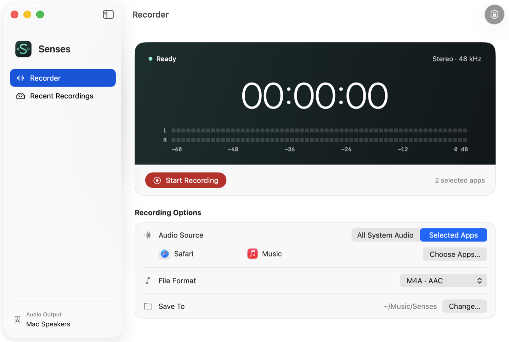

# Senses

Senses records audio from your Mac. Capture a single app, mix several apps into one file, or record everything playing through your current output. You can keep listening on your speakers or headphones while Senses saves the recording locally.



## Build and open Senses

You’ll need an Apple silicon Mac running macOS 26 or later, full Xcode with the macOS 26 SDK selected for command-line builds, and Rust 1.88 or later. Run these commands from the project folder. The bootstrap script installs a project-local Rust toolchain if Cargo is missing and fetches the dependencies pinned in `Cargo.lock`.

```sh
bash scripts/bootstrap.sh
bash scripts/build.sh
open build/Senses.app
```

The build produces an ad-hoc-signed development app. You can copy `build/Senses.app` to Applications and run it independently of the source folder and Rust toolchain. For development in Xcode, open `Senses.xcodeproj` after bootstrapping and select the **Senses** scheme.

## Make a recording

1. Open **Recorder** in the sidebar. Under **Recording Options**, leave **Audio Source** on **All System Audio** to include apps and system sounds.
2. To capture specific apps, switch to **Selected Apps**, click **Choose Apps…**, check the apps you want, and click **Done**. Each selection appears with its name and icon. Open an app if it’s missing from the picker. Selecting a browser includes audio from all its tabs.
3. Choose a **File Format**. **M4A** uses AAC at 256 kbps for smaller files. **WAV** uses uncompressed 24-bit PCM for editing. Both formats save 48 kHz stereo. Use **Change…** beside **Save To** to pick a folder. The default is `~/Music/Senses`.
4. Click **Start Recording** and allow system audio capture when macOS asks. Play audio in your source app and watch the **L** and **R** meters. **Pause** holds the timer and leaves the paused interval out of the file. **Resume** continues the same session.
5. Click **Stop & Save**, then open **Recent Recordings** in the sidebar. It shows the 12 most recently modified M4A and WAV files in the current destination. Use the magnifying glass beside a file to reveal it in Finder, or the folder button in the toolbar to open the entire folder.

If the meters stay silent, check that the selected app is playing through the device shown under **Audio Output**. Use the shield button in the Recorder toolbar to open **System Settings → Privacy & Security → Screen & System Audio Recording**, enable Senses, and start a new recording. Follow any relaunch prompt from macOS.

### Menu bar and keyboard shortcuts

Closing the window keeps the recorder available in the menu bar. From the Senses menu-bar icon you can record, pause, resume, stop and save, or reopen the window. Quitting Senses finishes the current recording.

| Action | Shortcut while Senses is active |
| --- | --- |
| Start recording | ⌘R |
| Pause or resume | ⇧⌘P |
| Stop and save | ⌘. |

### Files and interruptions

Files are named like `Senses_2026-11-12_09-30-00.m4a`. A recording has a `.partial` suffix until it finishes saving. Existing files are preserved if a name is already in use. A crash or write failure can leave a partial file that needs manual recovery.

A change of output device or device clock starts a numbered part and may leave a brief gap. Long WAV sessions also split into parts before 3.5 GiB. Senses prevents idle system sleep during capture. Putting the Mac to sleep explicitly ends the session.

## Development

The SwiftUI window, menu-bar controls, and app selection live in [native](native/). The [Rust engine](engine/src/) manages Core Audio process taps, a bounded audio queue, conversion, and file finalization. The writer uses the active device’s clock to convert audio to 48 kHz, including when Bluetooth playback runs at 44.1 kHz. The microphone is excluded from capture.

```sh
bash scripts/test.sh                     # Rust unit tests, Clippy, and Swift app-selection checks
SENSES_SOAK_SECONDS=60 bash scripts/soak.sh  # One-minute synthetic writer test
bash scripts/soak.sh --fast               # Process four hours of samples faster than real time
bash scripts/soak.sh                      # Four-hour real-time endurance test
```

The automated tests use synthetic audio and run silently. Run the codec tests in a normal macOS terminal so Audio Toolbox can reach the AAC encoder. The four-hour tests need approximately 4.5 GB of temporary space and write metrics to `build/soak-report.json`. Hardware observations and remaining manual checks are recorded in [VALIDATION.md](VALIDATION.md).

The [design assets](design/) include the editable S-waveform logo and app icon. Run `bash scripts/brand.sh` to regenerate them from [SensesBrand.swift](native/SensesBrand.swift).
