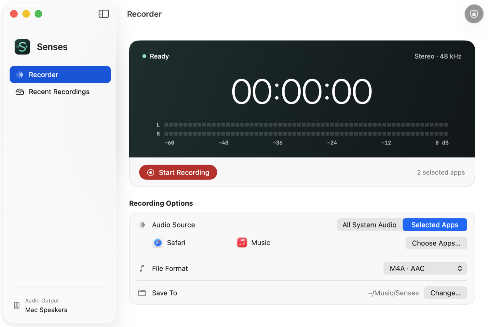

# Senses Design System

Use the same monitor, controls, and settings rows that ship in Senses in another macOS app. The SwiftUI library supports macOS 14 and later. It has no external dependencies. A [JSON token file](tokens.json) gives designers and developers on other platforms the colors, text styles, and dimensions.



## Add it to a SwiftUI app

In Xcode, choose **File → Add Package Dependencies**, enter `https://github.com/anridev/senses-recorder.git`, select version **0.1.1**, and add the **SensesDesignSystem** library to your app target. For an offline project, unzip the design-system download, choose **Add Local…** in the same dialog, and select the folder containing `Package.swift`.

Import `SensesDesignSystem` in a view. This settings group adopts the Mac’s appearance and accent color, and binds a native switch to your own state.

```swift
import SensesDesignSystem
import SwiftUI

struct ExportSettings: View {
    @State private var includeMetadata = true

    var body: some View {
        SensesSettingsGroup("Export Options") {
            LabeledContent {
                Toggle("Include metadata", isOn: $includeMetadata)
                    .labelsHidden().toggleStyle(.switch)
            } label: {
                Label("Include Metadata", systemImage: "tag")
            }
        }
        .padding(SensesStyle.pageInset)
    }
}
```

For a complete screen, add [ReadingSessionView.swift](ReadingSessionView.swift) to your app target and present `ReadingSessionView()`. It uses the monitor for a page count, a progress bar for the daily goal, and a stepper in the settings group. Each component takes ordinary SwiftUI views or values. Your app owns their state.

## Components

| Component | Where to use it |
| --- | --- |
| `SensesMonitorCard` | Give one live value priority. Supply status text, a status color, secondary metadata, the formatted value, and a spoken label. The detail slot holds a chart or progress view. The action slot takes buttons and optional context. |
| `SensesSettingsGroup` | Group settings that affect the same task. Use a `LabeledContent` per row, a native control on the right, and a `Divider()` between rows. |
| `SensesIconLabel` | Identify a selected item with its name and image. An omitted image uses the app symbol. Use 20 pt in an action bar, 22 pt in an inline selection, and 25 pt in a picker. |
| `SensesStereoMeter` | Pass left and right linear peaks from 0 to 1 to display a −60 to 0 dB meter. The host supplies the readings. |
| `SensesStyle` | Use the named colors, readout and meter fonts, corner radii, page inset, section spacing, and maximum content width in custom views. |

## Apply the visual style

| Element | Value and use |
| --- | --- |
| Window | Use a native split view and sidebar list. In Senses the sidebar is 182–255 pt wide, with 210 pt preferred. The detail column has 24 pt padding, 22 pt between sections, and a 760 pt content limit. |
| Monitor | Use a fixed dark gradient from top left to bottom right, approximately `#1C3633` to `#0E171B`. Set the main value in the rounded system font at 65 pt, light, with equal-width digits. The card radius is 18 pt. Use white for the value and 72% white for its metadata. |
| State and action | Pair each status color with text. Senses uses mint for Ready, system red for Recording, and system orange for Paused. The record button uses `#C7262E`. Reserve this red for recording. Other main actions use the user’s accent color. |
| Settings | Draw a secondary system background with a 14 pt radius and an 8% primary-color outline. Rows have a minimum height of 45 pt. Place icons in an 18 pt column to align labels. |
| Type and icons | Use system headline for section names, body for labels, callout for supporting information, and caption for dates and paths. Use SF Symbols for actions and the item’s own icon for identity. |
| Appearance and accessibility | Use semantic colors for the window, controls, labels, and dividers. The instrument display stays dark in both appearances. Pass a meaningful spoken label for the readout, retain keyboard navigation, and pair icon-only actions with an accessible name. |

For another product, replace the sidebar identity with your own icon and name. The [Senses logo](../Senses-Logo.svg) is included as a reference. On another platform, map the system color roles in the JSON file to that platform’s light and dark theme colors and use its native controls.
